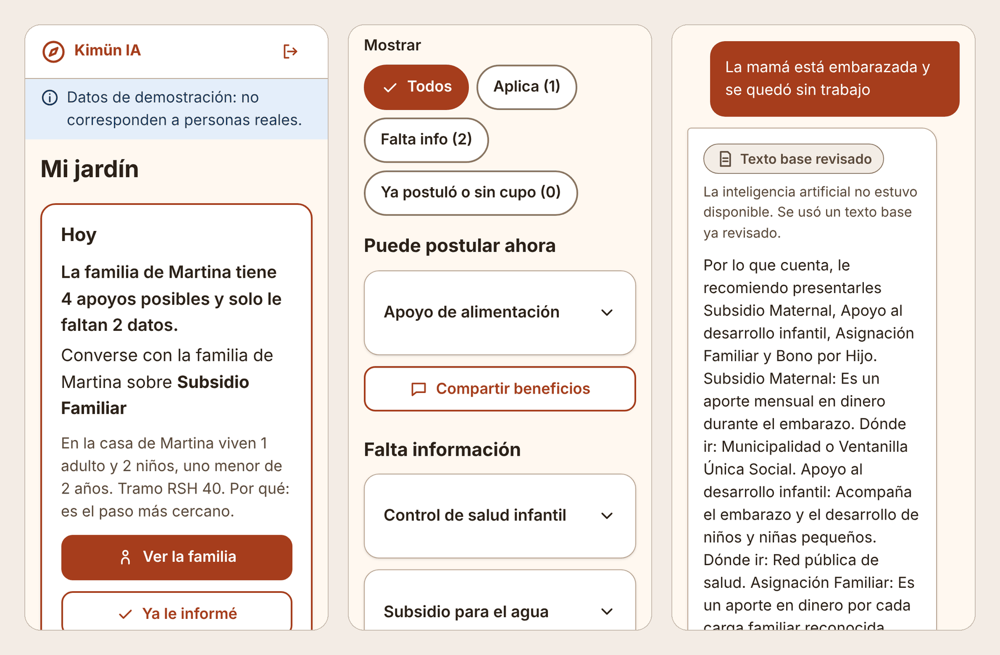
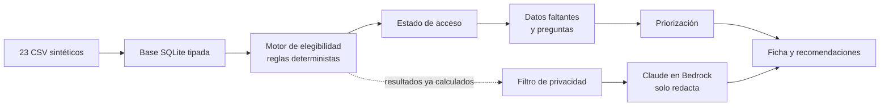
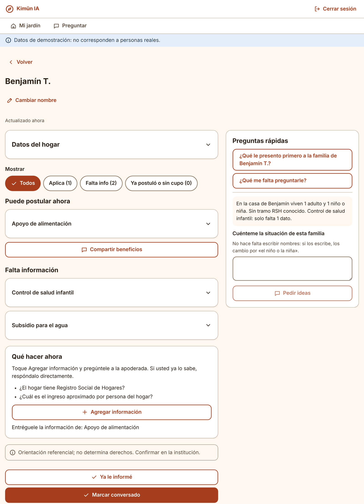

# Kimün IA — Asistente de beneficios para familias

[](https://github.com/brnrddo/Family-benefits-assistant-FundacionIntegra/actions/workflows/ci.yml)


**🇬🇧 [Read in English](README.md)**

Una PWA pensada para el celular que ayuda a las educadoras de **Fundación Integra** a encontrar familias que cumplen los requisitos de un beneficio social pero no lo reciben, y a decidir qué conversación tener primero.

Construida por un equipo de cuatro personas en una **hackathon de AWS de tres días** (*AWS Breaking Barriers*, octubre de 2026) y desplegada de punta a punta en AWS.



---

## El problema

Muchas familias cumplen los requisitos para recibir beneficios sociales, pero nunca llegan a solicitarlos: no saben que existen, les falta un documento o se les pasa el plazo de postulación. Las educadoras de los jardines conversan con estas familias todos los días, pero no tienen una forma simple de saber **qué beneficio conversar, con quién y con qué urgencia**.

## La solución

Para cada familia del jardín, la app muestra:

- **Oportunidades**: beneficios para los que la familia es elegible, incluido el caso clave de *elegible pero sin asignación*.
- **Datos faltantes y preguntas**: qué información falta para confirmar una elegibilidad y cómo pedirla.
- **Prioridad**: qué familias atender primero, según la acción que deben tomar (postular antes de un cierre, entregar un documento, etc.), su urgencia y el valor del beneficio.
- **Guion y mensajes**: textos redactados por IA para conversar con la familia o enviarle un recordatorio.
- **Asistente conversacional**: la educadora puede agregar información nueva. Por ejemplo, si indica que la madre está embarazada nuevamente, el sistema reevalúa a la familia y recomienda el subsidio maternal, marcado como *preliminar* hasta que se acredite.

## Decisión de diseño principal: la IA no decide



- **Motor determinista como fuente de verdad.** 151 reglas versionadas con lógica de tres valores (`SI / NO / INDETERMINADO`), nivel `CONFIRMADO` o `PRELIMINAR` y una traza regla por regla. Así se distingue "no califica" de "no sabemos", y se puede explicar cada resultado.
- **Brecha de acceso, no solo elegibilidad.** El motor cruza la elegibilidad con las postulaciones y pagos reales de la familia y produce 8 estados de acceso, entre ellos `ELEGIBLE_SIN_ASIGNACION` (el problema accionable) y `SIN_CUPO`.
- **IA acotada a la redacción.** El LLM recibe resultados ya calculados y datos ya filtrados. Puede explicar y conversar, pero no puede inventar una elegibilidad. Si Bedrock falla, la API responde con plantillas deterministas sin romperse.

## Privacidad desde el diseño

Aunque todos los datos son sintéticos, el sistema se diseñó como si trabajara con familias reales:

1. **Filtro por allowlist** antes del LLM: solo salen del backend los campos explícitamente permitidos.
2. **Bedrock Guardrails** como segunda barrera.
3. **Inspección de egreso** de las respuestas del modelo.
4. **Nombres de trato locales**: los nombres reales nunca salen del dispositivo; el asistente reemplaza los nombres que escribe la usuaria.
5. **Falla cerrado**: ante cualquier duda, no se envía información.

## Arquitectura en AWS

Durante la hackathon el sistema completo se desplegó y se probó en `us-east-1` ([bitácora de evidencia sanitizada](docs/arquitectura/EVIDENCIA_AWS_2026-10-15.md)):

| Capa | Servicio |
| --- | --- |
| Hosting del frontend | AWS Amplify Hosting |
| Autenticación | Amazon Cognito + autorizador JWT |
| API | API Gateway (HTTP API) → AWS Lambda (FastAPI con Mangum) |
| Datos | S3 privado (snapshot SQLite sintético) · DynamoDB (con TTL) |
| IA generativa | Amazon Bedrock: Claude Haiku 4.5 vía Converse API, Bedrock Guardrails |
| Precálculo | Stack de AWS CDK con Lambdas para particiones del snapshot ([`infrastructure/`](infrastructure/)) |

Más detalle en [Arquitectura AWS](docs/ARQUITECTURA_AWS.md).

<details>
<summary>Vista de escritorio de la ficha familiar</summary>



</details>

## Stack

| Área | Tecnología |
| --- | --- |
| Datos y motor | Python 3.11+, SQLite (solo biblioteca estándar) |
| API | FastAPI, contrato OpenAPI como fuente de verdad |
| IA generativa | Amazon Bedrock (Claude Haiku 4.5, Converse API), Guardrails |
| Frontend | React, TypeScript, Vite, PWA (funciona sin conexión), TanStack Query, modo mock con MSW |
| Calidad | pytest (540+ tests), Vitest (410+ tests), smoke e2e con Playwright + axe (accesibilidad), ruff, ESLint, GitHub Actions |
| Proceso | Desarrollo guiado por specs con [Kiro](https://kiro.dev): specs, steering y contratos compartidos en [`.kiro/specs/`](.kiro/specs/INDICE.md) |

## Cómo ejecutarlo

No necesita credenciales de AWS: por defecto la API responde con mocks sintéticos y el asistente usa plantillas locales.

**Backend** (Python 3.11+)

```bash
cd backend
pip install -r requirements-dev.txt
python -m app.loader.load        # genera e3.db desde los 23 CSV
python -m app.db.build_views     # precálculo: 10.000 evaluaciones en < 30 s
pytest                           # suite de tests
uvicorn app.api.app:app --port 8000
```

Con `E3_MOCK=0` la API sirve resultados del motor real. Para usar Bedrock, exporta las variables en la misma terminal (el backend no lee archivos `.env`):

```bash
export E3_MOCK=0
export E3_LLM_PROVIDER=bedrock
export E3_BEDROCK_MODEL_ID=us.anthropic.claude-haiku-4-5-20251001-v1:0
export E3_BEDROCK_REGION=us-east-1
```

Revisa [`.env.example`](.env.example) para la lista completa. Las credenciales de AWS nunca van en archivos.

**Frontend** (Node 22)

```bash
cd frontend
npm install
npm run dev:mock   # mocks sintéticos en el navegador, sin backend → http://localhost:5173
npm run dev:api    # contra la API local en :8000
```

## Estructura del repositorio

```
backend/
  app/loader/     # carga de los 23 CSV a SQLite
  app/engine/     # motor de elegibilidad con traza
  app/access/     # estado de acceso (8 estados)
  app/context/    # ficha, contexto de familia y filtro de privacidad
  app/priority/   # priorización
  app/genai/      # LLMProvider, StubProvider y BedrockProvider
  app/api/        # routers FastAPI bajo /api/v1
  deploy/         # empaquetado para Lambda
frontend/         # PWA en React (features en src/features/)
content/          # catálogo de beneficios, prompts, textos y pesos de priorización
data/publico/     # dataset sintético canónico (23 CSV) + generador y validador
infrastructure/   # stack de precálculo en AWS CDK
.kiro/specs/      # specs de Kiro y contratos compartidos de API y datos (los usan el código y los tests)
docs/             # especificación, arquitectura, flujo de producto y privacidad
docs/hackathon/   # archivo del proceso interno del equipo durante la hackathon
```

## Limitaciones conocidas

- Prototipo construido en tres días sobre un dataset sintético fijo; no se ha probado con datos reales.
- Algunos campos (gestación, controles de salud, residencia) no vienen en el dataset, por lo que esos beneficios quedan `INDETERMINADO` salvo que la familia los declare, y en ese caso solo llegan a `PRELIMINAR`.
- Los umbrales viven junto a las reglas versionadas, lo que complica mantener cambios legislativos en el tiempo.
- El motor ejecuta reglas ya codificadas: traducir la normativa a reglas requiere criterio humano.
- La cobertura de pruebas es sólida en el motor y la API, pero de punta a punta hay un solo smoke test.

## Equipo

Construido durante la hackathon AWS Breaking Barriers por un equipo interdisciplinario de cuatro personas (ingeniería en computación, eléctrica, mecánica y recursos naturales):

- Bernardo Storniolo — [@brnrddo](https://github.com/brnrddo)
- Juan Pablo Castillo — [@jpcastillo714](https://github.com/jpcastillo714)
- Antonio Badilla
- Thomas Hole

## Documentación

- [Especificación del proyecto](docs/especificacion/PROYECTO_3_ESPECIFICACION_v2.md)
- [Arquitectura AWS](docs/ARQUITECTURA_AWS.md)
- [Política de privacidad y anonimización](docs/PRIVACIDAD_DEMO.md)
- [Flujo de la ficha familiar](docs/producto/FLUJO_DE_FICHA.md)
- [Dataset sintético](data/README.md)
- [Archivo del proceso de la hackathon](docs/hackathon/README.md)

---

*Todos los datos de este repositorio son sintéticos. Los resultados son orientación referencial y no constituyen una evaluación oficial de beneficios.*
