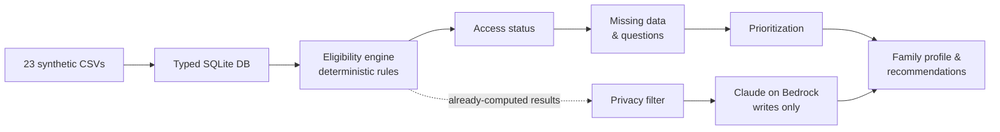

# Kimün IA — Family Benefits Assistant

[](https://github.com/brnrddo/Family-benefits-assistant-FundacionIntegra/actions/workflows/ci.yml)


**🇪🇸 [Leer en español](README.es.md)**

A mobile-first web app that helps early-childhood educators at **Fundación Integra** (Chile) find families who qualify for social benefits but aren't receiving them, and decide which conversation to have first.

Built by a team of four in a **3-day AWS hackathon** (*AWS Breaking Barriers*, October 2026) and deployed end to end on AWS.


---

## The problem

Many Chilean families meet the requirements for social benefits (family allowances, maternity subsidies, water subsidies…) but never apply: they don't know the benefit exists, they're missing a document, or the deadline passes. Kindergarten educators talk to these families every day, but have no simple way to know **which benefit to bring up, with whom, and how urgently**.

## What it does

For every family in a kindergarten, the app shows:

- **Opportunities** — benefits the family is eligible for, including the key case *eligible but not receiving it*.
- **Missing information** — what data is needed to confirm eligibility, and the exact question to ask.
- **Priority** — which families to talk to first, based on the action required (apply before a deadline, hand in a document…), urgency and benefit value.
- **Scripts and messages** — AI-drafted talking points and reminders for the family.
- **Conversational assistant** — the educator can add new information in plain language (e.g. *"the mother is pregnant again"*). The engine re-evaluates the family and surfaces the maternity subsidy, marked as *preliminary* until it's verified.

## Key design decision: the AI doesn't decide



- **A deterministic engine is the source of truth.** 151 versioned rules evaluated with three-valued logic (`SI / NO / INDETERMINADO`, i.e. yes / no / unknown), a `CONFIRMADO` or `PRELIMINAR` (confirmed / preliminary) level and a rule-by-rule trace. This separates *"doesn't qualify"* from *"we don't know yet"*, and every result can be explained.
- **Access gap, not just eligibility.** The engine crosses eligibility with the family's actual applications and payments, producing 8 access states, including `ELEGIBLE_SIN_ASIGNACION` (eligible but not receiving it — the actionable gap) and `SIN_CUPO` (no quota available).
- **The LLM only writes.** Claude receives already-computed, already-filtered results. It can explain and converse, but it cannot invent eligibility. If Bedrock fails, the API falls back to deterministic templates instead of breaking.

## Privacy by design

All data is synthetic, but the system was built as if it handled real families:

1. **Allowlist context filter** before the LLM — only explicitly permitted fields leave the backend.
2. **Amazon Bedrock Guardrails** as a second barrier.
3. **Egress inspection** of model responses.
4. **Local nicknames** — families' real names never leave the device; the assistant replaces names typed by the user.
5. **Fail closed** — when in doubt, nothing is sent.

## Architecture on AWS

During the hackathon the full stack was deployed and smoke-tested in `us-east-1` ([sanitized evidence log](docs/arquitectura/EVIDENCIA_AWS_2026-10-15.md)):

| Layer | Service |
| --- | --- |
| Frontend hosting | AWS Amplify Hosting |
| Auth | Amazon Cognito + JWT authorizer |
| API | API Gateway (HTTP API) → AWS Lambda (FastAPI via Mangum) |
| Data | S3 (private, synthetic SQLite snapshot) · DynamoDB (TTL) |
| Generative AI | Amazon Bedrock — Claude Haiku 4.5 via the Converse API, Bedrock Guardrails |
| Pre-computation | AWS CDK stack with Lambdas for snapshot partitions ([`infrastructure/`](infrastructure/)) |

More detail in [AWS architecture](docs/ARQUITECTURA_AWS.md) (Spanish).

<details>
<summary>Desktop view of a family profile</summary>


</details>

## Tech stack

| Area | Technology |
| --- | --- |
| Data & engine | Python 3.11+, SQLite (standard library only) |
| API | FastAPI, OpenAPI contract as the source of truth |
| Generative AI | Amazon Bedrock (Claude Haiku 4.5, Converse API), Guardrails |
| Frontend | React, TypeScript, Vite, PWA (offline-capable), TanStack Query, MSW mock mode |
| Quality | pytest (540+ tests), Vitest (410+ tests), Playwright + axe accessibility smoke test, ruff, ESLint, GitHub Actions |
| Process | Spec-driven development with [Kiro](https://kiro.dev): specs, steering files and shared API contracts in [`.kiro/specs/`](.kiro/specs/INDICE.md) |

## Run it locally

No AWS credentials needed: by default the API serves synthetic mocks and the assistant uses local templates.

**Backend** (Python 3.11+)

```bash
cd backend
pip install -r requirements-dev.txt
python -m app.loader.load        # build e3.db from the 23 CSVs
python -m app.db.build_views     # pre-compute 10,000 evaluations (< 30 s)
pytest                           # run the test suite
uvicorn app.api.app:app --port 8000
```

Set `E3_MOCK=0` to serve results from the real engine. To use Bedrock, export these variables in the same shell (the backend doesn't read `.env` files):

```bash
export E3_MOCK=0
export E3_LLM_PROVIDER=bedrock
export E3_BEDROCK_MODEL_ID=us.anthropic.claude-haiku-4-5-20251001-v1:0
export E3_BEDROCK_REGION=us-east-1
```

See [`.env.example`](.env.example) for the full list. AWS credentials never go in files.

**Frontend** (Node 22)

```bash
cd frontend
npm install
npm run dev:mock   # in-browser synthetic mocks, no backend needed → http://localhost:5173
npm run dev:api    # against the local API on :8000
```

## Repository layout

```
backend/
  app/loader/     # loads the 23 CSVs into SQLite
  app/engine/     # eligibility engine with traces
  app/access/     # access status (8 states)
  app/context/    # family profile, context and privacy filter
  app/priority/   # prioritization
  app/genai/      # LLMProvider, StubProvider and BedrockProvider
  app/api/        # FastAPI routers under /api/v1
  deploy/         # Lambda packaging
frontend/         # React PWA (features in src/features/)
content/          # benefit catalog, prompts, copy and prioritization weights
data/publico/     # canonical synthetic dataset (23 CSVs) + generator and validator
infrastructure/   # AWS CDK pre-computation stack
.kiro/specs/      # Kiro specs and shared API/data contracts (used by code and tests)
docs/             # specification, architecture, product flow, privacy
docs/hackathon/   # archive of the team's internal hackathon process
```

## Known limitations

- Prototype built in three days on a fixed synthetic dataset; not tested with real data.
- Some fields (pregnancy, health check-ups, residence) aren't in the dataset, so those benefits stay `INDETERMINADO` (unknown) unless the family declares them, and then only reach `PRELIMINAR`.
- Thresholds live alongside versioned rules, which makes tracking legislative changes over time harder.
- The engine runs rules that were already encoded: translating regulations into rules still needs human judgment.
- Test coverage is strong in the engine and API, but end-to-end coverage is a single smoke test.

## Team

Built during the AWS Breaking Barriers hackathon by an interdisciplinary team of four (computer, electrical, mechanical and natural-resources engineering):

- Bernardo Storniolo — [@brnrddo](https://github.com/brnrddo)
- Juan Pablo Castillo — [@jpcastillo714](https://github.com/jpcastillo714)
- Antonio Badilla
- Thomas Hole

## Documentation (Spanish)

- [Project specification](docs/especificacion/PROYECTO_3_ESPECIFICACION_v2.md)
- [AWS architecture](docs/ARQUITECTURA_AWS.md)
- [Privacy and anonymization policy](docs/PRIVACIDAD_DEMO.md)
- [Family profile flow](docs/producto/FLUJO_DE_FICHA.md)
- [Synthetic dataset](data/README.md)
- [Hackathon process archive](docs/hackathon/README.md)

---

*All data in this repository is synthetic. Results are guidance only and are not an official benefit assessment.*
