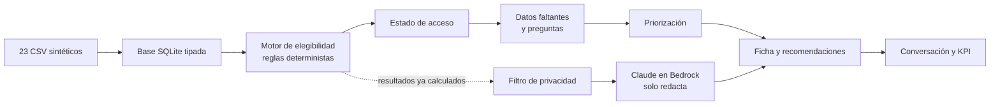

# Apoyo Inteligente para Familias

> **English summary**
> A progressive web app built in a three-day AWS hackathon for Fundación Integra, a Chilean early-childhood education foundation. It helps staff find families who qualify for social benefits but aren't receiving them, and ranks which conversations to have first. Eligibility, access status and priority are computed by a **deterministic, auditable rule engine** (150+ rules, three-valued logic with rule-by-rule traces). **Claude on Amazon Bedrock** is used only to explain results, write conversation scripts and power a chat assistant that captures new family information so the engine can re-evaluate it. Privacy is layered (allowlist context filter, Bedrock Guardrails, egress checks, fail-closed) and the whole system runs offline with a stub provider.
> **Stack:** Python · FastAPI · SQLite · Amazon Bedrock (Claude Haiku 4.5) · React · TypeScript · Vite · 88 automated tests.
> All data in this repository is synthetic.

---

## El problema

Muchas familias cumplen los requisitos para recibir beneficios sociales, pero nunca llegan a solicitarlos: no saben que existen, les falta un documento o se les pasa el plazo de postulación. Las educadoras de los jardines de Fundación Integra conversan con estas familias todos los días, pero no tienen una forma simple de saber **qué beneficio conversar, con quién y con qué urgencia**.

## La solución

Una PWA que, para cada familia del jardín, muestra:

- **Oportunidades**: beneficios para los que la familia es elegible, incluido el caso clave de *elegible pero sin asignación*.
- **Datos faltantes y preguntas**: qué información falta para confirmar una elegibilidad y cómo pedirla.
- **Prioridad**: qué familias atender primero, según la acción que deben tomar (postular antes de un cierre, entregar un documento, etc.), su urgencia y el valor del beneficio.
- **Guion y mensajes**: textos redactados por IA para conversar con la familia o enviarle un recordatorio.
- **Asistente conversacional**: la educadora puede agregar información nueva. Por ejemplo, si indica que la madre está embarazada nuevamente, el sistema reevalúa a la familia y recomienda el subsidio maternal, marcado como *preliminar* hasta que se acredite.

La información general sobre beneficios se muestra en una sección aparte y nunca se presenta como una evaluación de la familia. Todo resultado incluye un aviso de orientación referencial.

## Decisión de diseño principal: la IA no decide



- **Motor determinista como fuente de verdad.** Cada evaluación usa lógica de tres valores (SI / NO / INDETERMINADO) con nivel CONFIRMADO o PRELIMINAR y una traza regla por regla. Así se distingue "no califica" de "no sabemos", y se puede explicar cada resultado.
- **Brecha de acceso, no solo elegibilidad.** El motor cruza la elegibilidad con las gestiones reales de la familia y produce 8 estados de acceso, entre ellos `ELEGIBLE_SIN_ASIGNACION` (el problema accionable) y `SIN_CUPO`.
- **IA acotada a la redacción.** El LLM recibe resultados ya calculados y datos ya filtrados. Puede explicar y conversar, pero no puede inventar una elegibilidad. Si falla, la API responde con plantillas deterministas sin romperse.

## Privacidad

Aunque todos los datos son sintéticos, el sistema se diseñó como si trabajara con familias reales:

1. **Filtro por allowlist** antes del LLM: solo pasan los campos explícitamente permitidos (`context_filter.filtrar_para_llm`).
2. **Bedrock Guardrails** como segunda barrera.
3. **Inspección de egreso** de las respuestas del modelo.
4. **Nombres de trato locales**: nunca salen del dispositivo.
5. **Falla cerrado**: ante cualquier duda, no se envía información.

## Stack

| Capa | Tecnología |
| --- | --- |
| Datos y motor | Python 3.11+, SQLite (solo stdlib) |
| API | FastAPI, contrato OpenAPI como fuente de verdad |
| IA generativa | Amazon Bedrock (Claude Haiku 4.5 vía Converse API), Guardrails |
| Frontend | React, TypeScript, Vite, PWA, MSW para modo mock |
| Calidad | pytest (88 tests), ruff, GitHub Actions |

## Estructura del repositorio

```
backend/
  app/loader/     # carga de los 23 CSV a SQLite
  app/engine/     # motor de elegibilidad con traza
  app/access/     # estado de acceso (8 estados)
  app/context/    # ficha, contexto de familia y filtro de privacidad
  app/priority/   # priorización
  app/genai/      # LLMProvider, StubProvider y BedrockProvider
  app/api/        # routers FastAPI bajo /api/v1
  app/catalog/    # catálogo de contenido y plantillas
frontend/         # PWA (features en src/features/)
data/publico/     # dataset sintético canónico (23 CSV)
docs/             # especificación, arquitectura, producto y privacidad
```

## Cómo ejecutarlo

### Backend

```bash
cd backend
python -m app.loader.load          # genera e3.db desde los CSV
python -m app.db.build_views       # precálculo: 10.000 evaluaciones en < 30 s
pip install -r requirements-dev.txt
pytest                             # 88 tests
```

Por defecto la API responde con mocks y usa plantillas locales, así que **no necesita credenciales de AWS**. Para usar Bedrock, exporta las variables en la misma terminal que levanta el servidor (el backend no lee archivos `.env`):

```bash
export E3_MOCK=0
export E3_LLM_PROVIDER=bedrock
export E3_BEDROCK_MODEL_ID=us.anthropic.claude-haiku-4-5-20251001-v1:0
export E3_BEDROCK_REGION=us-east-1
```

Revisa [`.env.example`](.env.example) para la lista completa de variables. Las credenciales de AWS nunca van en archivos.

### Frontend

```bash
cd frontend
npm install
npm run dev
```

## Limitaciones conocidas

- Prototipo construido en tres días sobre un dataset sintético fijo; no se ha probado con datos reales.
- Algunos campos (gestación, controles de salud, residencia) no vienen en el dataset, por lo que esos beneficios quedan INDETERMINADO salvo que la familia los declare, y en ese caso solo llegan a PRELIMINAR.
- Los umbrales viven junto a las reglas versionadas, lo que complica mantener cambios legislativos en el tiempo.
- El motor ejecuta reglas ya codificadas: traducir la normativa a reglas requiere criterio humano.
- La cobertura de pruebas es sólida en el motor, pero mínima de punta a punta.

## Documentación

- [Especificación del proyecto](docs/especificacion/PROYECTO_3_ESPECIFICACION_v2.md)
- [Arquitectura AWS](docs/ARQUITECTURA_AWS.md)
- [Política de privacidad y anonimización](docs/PRIVACIDAD_DEMO.md)
- [Flujo de la ficha familiar](docs/producto/FLUJO_DE_FICHA.md)
- [Documentación del dataset sintético](data/README.md)

---

*Todos los datos de este repositorio son sintéticos. Los resultados son orientación referencial y no constituyen una evaluación oficial de beneficios.*