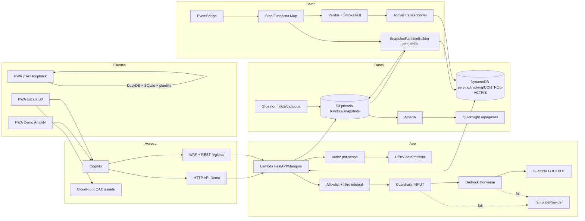

# Arquitectura AWS-first

**Estado del documento:** baseline documental aprobado. Los **ocho servicios del núcleo** pasan a `VERIFICADO_EN_CUENTA` con smoke tests fechados del **2026-10-15** en `us-east-1`: Bedrock Converse, Bedrock Guardrails, Lambda, API Gateway HTTP API, S3 privado, DynamoDB, Cognito y Amplify Hosting. Cada transición está trazada a una línea de la [bitácora fechada](./arquitectura/EVIDENCIA_AWS_2026-10-15.md). Todo lo demás —incluida la retención de CloudWatch, el resto de los permisos, las cuotas y los servicios fuera del núcleo— sigue sin verificación en cuenta. La referencia autenticada del evento del **2026-10-14** aporta procedencia, no disponibilidad. No se registran account IDs, credenciales ni endpoints privados: los identificadores operativos viven fuera del repositorio y entran al runtime por variables `E3_*` y `VITE_*` (DEC-090).

## Perfiles

| Perfil | Camino objetivo | Condición y recuperación |
|---|---|---|
| **Demo AWS viable** | Amplify, Cognito, API Gateway HTTP API, Lambda FastAPI/Mangum, S3 privado, DynamoDB, Bedrock + Guardrails, Step Functions Inline Map, EventBridge, CloudWatch y CDK | cada componente requiere smoke test. Los ocho del núcleo lo tienen fechado (2026-10-15); Step Functions, EventBridge, CDK y la retención de CloudWatch no. Sin Cognito no hay API cloud: PWA/API en loopback, DuckDB/SQLite y `TemplateProvider` |
| **Escala Integra** | S3 + CloudFront OAC, REST API regional + WAF, Distributed Map, Glue/Athena, QuickSight y búsqueda evaluable | requiere gobierno Integra, pruebas de cuenta, seguridad, costo y recuperación; no se hereda automáticamente de Demo |

DuckDB es exclusivamente fallback local. El cálculo cloud usa Python en la misma Lambda `SnapshotPartitionBuilder`; un fallback cloud manual invoca esa Lambda y los mismos validadores.

## Diagrama

CloudFront sirve solo assets; no proxy de API. WAF se asocia al stage REST de Escala. El authorizer valida antes de Lambda. Las fronteras son: autenticación/autorización; serving interactivo; batch; GenAI; y fallback seguro.

## Evidencia y transiciones

- `DOCUMENTADO_NO_VERIFICADO`: diseño local sin prueba.
- `NO_VERIFICADO`: componente AWS pendiente de prueba en cuenta/región.
- `VERIFICADO_EN_CUENTA`: prueba fechada exitosa con región, operación y evidencia sanitizada.
- `NO_DISPONIBLE`: prueba fechada fallida por servicio, modelo, permiso, cuota o compatibilidad.
- `VERIFICADO_LOCALMENTE`: prueba local reproducible; nunca demuestra AWS.

Procedencia separada: `DECLARADO_POR_EVENTO` o `NO_MENCIONADO_REQUIERE_VERIFICACION`. Flujo AWS: `NO_VERIFICADO → VERIFICADO_EN_CUENTA | NO_DISPONIBLE`; un cambio material devuelve a `NO_VERIFICADO`. Local: `DOCUMENTADO_NO_VERIFICADO → VERIFICADO_LOCALMENTE`.

### Transiciones del 2026-10-15 (us-east-1)

Bitácora: [`arquitectura/EVIDENCIA_AWS_2026-10-15.md`](./arquitectura/EVIDENCIA_AWS_2026-10-15.md), ejecutada desde AWS CloudShell con `assumed-role/WSParticipantRole/Participant`, sin credenciales en disco (DEC-090). Cada fila nombra la operación que respalda la transición; ninguna otra fila de la matriz cambia de estado.

| Servicio | Transición | Operación que la respalda | Bloque |
|---|---|---|---|
| Bedrock Converse | `NO_VERIFICADO → VERIFICADO_EN_CUENTA` | `bedrock-runtime:Converse` con `us.anthropic.claude-haiku-4-5-20251001-v1:0` respondió; `ListInferenceProfiles` ve 34 perfiles de Anthropic | A |
| Bedrock Guardrails | `NO_VERIFICADO → VERIFICADO_EN_CUENTA` | `CreateGuardrail` + `CreateGuardrailVersion` (v1) y `ApplyGuardrail`: `GUARDRAIL_INTERVENED` ante manipulación del prompt, `NONE` ante pregunta legítima | B |
| Lambda (zip + Mangum) | `NO_VERIFICADO → VERIFICADO_EN_CUENTA` | `CreateFunction` python3.12 / 1024 MB / 29 s y `Invoke` sobre `GET /healthz` → 200 | D |
| API Gateway HTTP API | `NO_VERIFICADO → VERIFICADO_EN_CUENTA` | API creada sin `--target`, con rutas por método: preflight `OPTIONS` → 204 con `Access-Control-Allow-Origin`, ruta con datos sin token → 401, `GET /healthz` → 200 | D-bis y D-ter |
| S3 privado | `NO_VERIFICADO → VERIFICADO_EN_CUENTA` | `GetPublicAccessBlock` confirma las cuatro banderas de bloqueo en `true`; `PutObject` del snapshot sintético | E |
| DynamoDB | `NO_VERIFICADO → VERIFICADO_EN_CUENTA` | `CreateTable` PAY_PER_REQUEST `pk`/`sk` → `ACTIVE` y `DescribeTimeToLive` → `ENABLED` sobre `ttl`. Alcance: tabla y TTL; el runtime todavía no la usa | E |
| Cognito User Pools | `NO_VERIFICADO → VERIFICADO_EN_CUENTA` | grupo de usuarios con autorregistro deshabilitado y `email` como único atributo obligatorio, cliente público sin secreto con flujo `code`, autorizador JWT sobre las rutas con datos y usuario de demo `CONFIRMED` | F |
| Amplify Hosting | `NO_VERIFICADO → VERIFICADO_EN_CUENTA` | despliegue manual sin Git del build `demo` (sin mocks, copy canónico del Rol 4) con dominio HTTPS asignado | G |
| FastAPI/Pydantic/Mangum | `DOCUMENTADO_NO_VERIFICADO → VERIFICADO_EN_CUENTA` | el mismo `lambda:Invoke` del bloque D prueba el camino zip → Mangum → FastAPI en la nube; no es un noveno servicio, es la misma evidencia | D |

Hito funcional: la SQLite sintética (21 MB, 500 familias, 20 beneficios, 10.000 evaluaciones y 10.000 accesos) se construyó en 5,66 s, se subió al bucket privado y la Lambda la baja a `/tmp` en el arranque en frío. El log confirma `e3_db_descargada` y `motor_real_snapshot_listo familias=500 jardines=50` **sin** `runtime_degradado_a_mock`: la degradación silenciosa a mocks queda descartada con evidencia.

### Lo que no se pudo verificar

Ninguna de estas afirmaciones tiene respaldo y ninguna se da por hecha:

- **Retención de CloudWatch.** Los logs de la Lambda llegan; falta `put-retention-policy`. CloudWatch sigue `NO_VERIFICADO`.
- **Bedrock en runtime.** El proveedor está conectado en código pero apagado: la función corre con `E3_LLM_PROVIDER=stub`. La evidencia del bloque A es de la cuenta, no del runtime.
- **DynamoDB en runtime.** La caché de textos y el registro de conversaciones siguen en memoria de cada instancia de Lambda.
- **Código desplegado.** La función corre un zip anterior a los PR #20, #21, #22, #24 y #26; falta reconstruirlo desde `main` y hacer `update-function-code`.
- **Extremo a extremo con login real en navegador.** No se midió el inicio de sesión con PKCE, ni una petición con datos usando el token, ni el logout. Tampoco si el 401 del autorizador trae `Access-Control-Allow-Origin` (PREG-032).
- **Alcance del rol del escritorio Kiro.** Lo verificado es el alcance de la identidad de CloudShell, que cubrió todo lo necesario incluida la creación de roles de IAM. La pregunta sobre el escritorio sigue abierta porque ese entorno no se usó.
- **Permisos, cuotas y costos** más allá de las operaciones listadas, y **IaC**: no hay stack CDK desplegado. El despliegue del 2026-10-15 fue manual y la reproducibilidad depende de la bitácora.
- **Todo lo que está fuera del núcleo** en la matriz: Step Functions, EventBridge, Glue, Athena, QuickSight, Kendra/OpenSearch, S3 Vectors, AgentCore, Macie, Textract, Polly, Translate, Transcribe, X-Ray, KMS, Secrets Manager, Budgets y CloudFront + WAF.

## Matriz necesidad → servicio

| Necesidad | Servicio/tecnología | Motivo | Perfil | Procedencia | Estado | Limitación/costo cualitativo | Fallback |
|---|---|---|---|---|---|---|---|
| Hosting rápido | Amplify Hosting | HTTPS y publicación PWA | Demo | DECLARADO_POR_EVENTO | VERIFICADO_EN_CUENTA (2026-10-15) | despliegue manual sin Git; el zip se arma con `tar`, no con `Compress-Archive`; la reescritura SPA la pone Amplify y las rutas internas responden 404 aunque entreguen la página | Vite local |
| Assets privados | S3 + CloudFront OAC | caché y origen privado | Escala | DECLARADO_POR_EVENTO | NO_VERIFICADO | configuración | Amplify Demo |
| Identidad | Cognito User Pools | access tokens administrados | Ambos | NO_MENCIONADO_REQUIERE_VERIFICACION | VERIFICADO_EN_CUENTA (2026-10-15) | autorregistro deshabilitado y usuario de demo creado por administrador; `update-user-pool-client` reemplaza la configuración completa; login real en navegador sin medir | solo loopback |
| API Demo | API Gateway HTTP API + Lambda | serverless simple | Demo | DECLARADO_POR_EVENTO | VERIFICADO_EN_CUENTA (2026-10-15) | arranque en frío ~5,5 s totales; la API se crea sin `--target` porque la ruta `$default` administrada rompe el preflight CORS y no se puede borrar | Uvicorn local |
| API protegida | REST regional + WAF | stage protegido | Escala | mixta | NO_VERIFICADO | más costo/configuración | no exponer Escala |
| Contrato web | FastAPI/Pydantic/Mangum | misma validación cloud/local | Ambos | local | VERIFICADO_EN_CUENTA (2026-10-15) | zip de 18,1 MB comprimido / 45 MB descomprimido; el backend no trae CORS propio ni define `OPTIONS`, el CORS lo resuelve el gateway | mismo proceso local |
| Objetos/snapshots | S3 privado | bundles durables | Ambos | DECLARADO_POR_EVENTO | VERIFICADO_EN_CUENTA (2026-10-15) | las cuatro banderas de bloqueo público en `true`; lifecycle y versionado sin configurar | archivos sintéticos locales |
| Serving/control | DynamoDB | baja latencia, TTL, condicionales | Ambos | DECLARADO_POR_EVENTO | VERIFICADO_EN_CUENTA (2026-10-15) | alcance probado: tabla `pk`/`sk` y TTL `ENABLED`. El runtime todavía no la usa (caché y conversaciones en memoria) y `CONTROL/ACTIVE` sigue sin probar | SQLite local |
| Cálculo por jardín | Lambda `SnapshotPartitionBuilder` | mismo motor Python por partición | Ambos | DECLARADO_POR_EVENTO | NO_VERIFICADO | esta función no existe todavía: lo verificado el 2026-10-15 es la Lambda de la API, que construye el snapshot completo en su arranque en frío | invocación cloud manual; local DuckDB |
| Orquestación | Step Functions Inline/Distributed Map | 50/1.200 jardines | Ambos | DECLARADO_POR_EVENTO | NO_VERIFICADO | cuotas/estados | invocador de la misma Lambda |
| Agenda/eventos | EventBridge | recálculo y aprobación desacoplados | Ambos | DECLARADO_POR_EVENTO | NO_VERIFICADO | permisos/frecuencia | ejecución manual |
| Normalización | Glue Catalog/ETL | esquema y curated antes del cálculo | Escala/SHOULD | DECLARADO_POR_EVENTO | NO_VERIFICADO | arranque/complejidad | Python de ingesta |
| Analítica SQL | Athena | consulta de snapshots, no serving | Escala | DECLARADO_POR_EVENTO | NO_VERIFICADO | escaneo | agregados DynamoDB/local |
| Lakehouse | S3 Tables/Iceberg | analítica opcional | Escala/COULD | DECLARADO_POR_EVENTO | NO_VERIFICADO | operación/formato | Parquet + Athena |
| Redacción | Bedrock Converse | explica hechos resueltos | Ambos | DECLARADO_POR_EVENTO | VERIFICADO_EN_CUENTA (2026-10-15) | `us.anthropic.claude-haiku-4-5-20251001-v1:0` disponible y respondiendo; APAGADO en runtime (`E3_LLM_PROVIDER=stub`), cuota y latencia bajo carga sin medir | `TemplateProvider` |
| Segunda barrera | Bedrock Guardrails | filtra entrada/salida | Ambos | NO_MENCIONADO_REQUIERE_VERIFICACION | VERIFICADO_EN_CUENTA (2026-10-15) | versión 1 publicada; sin filtro `NAME` a propósito (nombres de trato sintéticos); falsos positivos/negativos solo con dos casos | sin Guardrail no hay Bedrock; plantilla |
| Catálogo pequeño | búsqueda determinista S3/DynamoDB | auditable para 20 beneficios | Ambos | diseño | DOCUMENTADO_NO_VERIFICADO | menor semántica | fuente oficial |
| Vectorial liviano | S3 Vectors | candidato simple | Escala/SHOULD | DECLARADO_POR_EVENTO | NO_VERIFICADO | API/región por probar | determinista |
| RAG alternativo | KB+OpenSearch, Kendra u OpenSearch directo | alternativas excluyentes | Escala/COULD | DECLARADO_POR_EVENTO | NO_VERIFICADO | recursos/costo persistente | S3 Vectors o determinista |
| OCR afiche | Textract | borrador desde asset sintético | COULD | DECLARADO_POR_EVENTO | NO_VERIFICADO | calidad variable | formulario manual |
| Audio salida | Polly | accesibilidad de texto validado | SHOULD | DECLARADO_POR_EVENTO | NO_VERIFICADO | voz/idioma/costo | texto visible |
| Traducción salida | Translate | idioma permitido sobre texto seguro | SHOULD | DECLARADO_POR_EVENTO | NO_VERIFICADO | calidad cultural | español canónico |
| Entrada audio | Transcribe | futura extensión con consentimiento | COULD | DECLARADO_POR_EVENTO | NO_VERIFICADO | alto riesgo de PII | entrada tipada |
| Agente catálogo | AgentCore | evaluar asistente aislado | COULD | DECLARADO_POR_EVENTO | NO_VERIFICADO | complejidad/costo | Lambda actual |
| KPI ejecutivo | QuickSight | agregados suprimidos | Escala/SHOULD | DECLARADO_POR_EVENTO | NO_VERIFICADO | licencias/preparación | panel React |
| Detección PII | Macie | alerta, no anonimiza | Escala/COULD | DECLARADO_POR_EVENTO | NO_VERIFICADO | costo/falsos positivos | inventario/allowlists |
| Permisos | IAM mínimo privilegio | separa API/pipeline/deploy | Ambos | NO_MENCIONADO_REQUIERE_VERIFICACION | NO_VERIFICADO | el 2026-10-15 se creó el rol de ejecución de la Lambda con política inline de mínimo privilegio (un perfil de inferencia, un guardrail, solo `snapshots/*` del bucket, una tabla); la separación API/pipeline/deploy sigue sin probar | no hay fallback inseguro |
| Cifrado | KMS/administrado | protección y auditoría | Ambos | NO_MENCIONADO_REQUIERE_VERIFICACION | NO_VERIFICADO | gestión de claves | cifrado administrado |
| Secretos/config | Secrets Manager + Parameter Store | secretos y operación no versionada | Ambos | NO_MENCIONADO_REQUIERE_VERIFICACION | NO_VERIFICADO | lecturas/rotación | `.env` local no versionado |
| Observabilidad | CloudWatch | logs/métricas/alarmas | Ambos | NO_MENCIONADO_REQUIERE_VERIFICACION | NO_VERIFICADO | los logs de la Lambda llegan (el arranque en frío se leyó ahí), pero la retención corta no se fijó y no hay dashboards ni alarmas: sin `put-retention-policy` no hay transición | logs locales sanitizados |
| Trazas | X-Ray | diagnóstico muestreado | SHOULD | NO_MENCIONADO_REQUIERE_VERIFICACION | NO_VERIFICADO | volumen | correlation ID |
| IaC | CDK v2 Python | stacks repetibles | Ambos | NO_MENCIONADO_REQUIERE_VERIFICACION | NO_VERIFICADO | bootstrap/permisos | pasos manuales solo diagnóstico |
| Control costo | Budgets/alertas | advertir consumo | Ambos | NO_MENCIONADO_REQUIERE_VERIFICACION | NO_VERIFICADO | no detiene recursos | alarmas/apagado manual |
| Revisión/operación | Security Agent / DevOps Agent | apoyo no runtime | COULD | DECLARADO_POR_EVENTO | NO_VERIFICADO | no sustituye revisión | revisión humana |

## Datos, activación y fallos

S3 guarda el snapshot canónico y DynamoDB su proyección. `CONTROL/ACTIVE` contiene exactamente `snapshot_id`, `eligibility_bundle_hash`, `content_bundle_hash`, `content_version`, `published_at` y `generation`. Activación y rollback reemplazan los seis campos mediante transacción condicional; competencia produce `SUPERSEDED`. API lee una vez consistentemente y falla cerrada ante divergencia. SSM no guarda punteros activos.

Pipeline: `IngestarRaw → ValidarEsquema → CatalogarNormalizar → MapConstruirParticiones → ValidarSnapshot → SmokeTest → ActivarSnapshot → EmitirEvento`. Demo exige 50 jardines y 10.000 evaluaciones; Escala hasta 1.200. Fallo de hash/schema/conteo conserva el activo anterior. Reintentos son acotados; logs nunca contienen filas.

## GenAI, C4, RAG y accesibilidad

La [política de privacidad](./PRIVACIDAD_DEMO.md) obliga allowlist y serialización cerrada antes de Guardrails/Converse. C3 recibe requests públicos mínimos; el servidor construye los dos envelopes internos desde C1/C2/C4 autorizados, sin aceptar contexto, catálogo o prompt del cliente. Textract es separado. Guardrails INPUT/OUTPUT y postvalidación nunca modifican elegibilidad, acceso, U/B/V ni posición. Consultas individuales al asistente no llaman Bedrock. Caché usa hash del envelope filtrado y versiones, sin ID familiar.

C4 es la autoridad cerrada de toda configuración numérica de §8: señales/umbrales/ventanas U, anualización/divisor/equivalencias/medianas B, ponderaciones/mapeos V, siete pesos de estado/bonus y prioridad familiar. Sus seis clases de archivo son obligatorias. El futuro `validate_content` comprueba hashes, referencias, suma, rangos e invariantes antes de ranking/build/publicación; no se implementa en esta fase documental.

El mensaje cruza C3 como `PrintableCard` de strings y citas tipadas, nunca como HTML/CSS generado. El frontend escapa los strings y controla todo el markup mediante `CARD_V1`; solo citas HTTPS autorizadas originan enlaces. Casos con scripts, handlers, estilos, URLs o markup malformado permanecen inertes o activan fallback.

RAG baseline es determinista. S3 Vectors y las alternativas excluyentes solo se adoptan tras benchmark sintético de cobertura, citas, latencia y costo. Polly/Translate empiezan deshabilitados y solo se activan mediante C4 con evidencia `VERIFICADO_EN_CUENTA`, allowlists y etiquetas de fallback; reciben texto seguro postvalidado y fallan a texto/español. Modelo y región quedan fijados por la evidencia del 2026-10-15 (`us.anthropic.claude-haiku-4-5-20251001-v1:0` en `us-east-1`), con el modelo todavía configurable por `E3_BEDROCK_MODEL_ID` (DEC-018); voz e idioma no se fijan hasta evidencia fechada propia.
