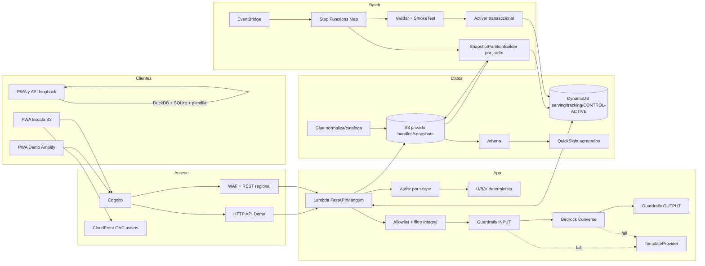

# Arquitectura AWS-first

**Estado del documento:** baseline documental aprobado; servicios, modelos, región, permisos y cuotas siguen sin verificación en cuenta. La referencia autenticada del evento del **2026-10-14** aporta procedencia, no disponibilidad. No se registran account IDs, credenciales ni endpoints privados.

## Perfiles

| Perfil | Camino objetivo | Condición y recuperación |
|---|---|---|
| **Demo AWS viable** | Amplify, Cognito, API Gateway HTTP API, Lambda FastAPI/Mangum, S3 privado, DynamoDB, Bedrock + Guardrails, Step Functions Inline Map, EventBridge, CloudWatch y CDK | cada componente requiere smoke test. Sin Cognito no hay API cloud: PWA/API en loopback, DuckDB/SQLite y `TemplateProvider` |
| **Escala Integra** | S3 + CloudFront OAC, REST API regional + WAF, Distributed Map, Glue/Athena, QuickSight y búsqueda evaluable | requiere gobierno Integra, pruebas de cuenta, seguridad, costo y recuperación; no se hereda automáticamente de Demo |

DuckDB es exclusivamente fallback local. El cálculo cloud usa Python en la misma Lambda `SnapshotPartitionBuilder`; un fallback cloud manual invoca esa Lambda y los mismos validadores.

## Diagrama

CloudFront sirve solo assets; no proxy de API. WAF se asocia al stage REST de Escala. El authorizer valida antes de Lambda. Las fronteras son: autenticación/autorización; serving interactivo; batch; GenAI; y fallback seguro.

## Evidencia y transiciones

- `DOCUMENTADO_NO_VERIFICADO`: diseño local sin prueba.
- `NO_VERIFICADO`: componente AWS pendiente de prueba en cuenta/región.
- `VERIFICADO_EN_CUENTA`: prueba fechada exitosa con región, operación y evidencia sanitizada.
- `NO_DISPONIBLE`: prueba fechada fallida por servicio, modelo, permiso, cuota o compatibilidad.
- `VERIFICADO_LOCALMENTE`: prueba local reproducible; nunca demuestra AWS.

Procedencia separada: `DECLARADO_POR_EVENTO` o `NO_MENCIONADO_REQUIERE_VERIFICACION`. Flujo AWS: `NO_VERIFICADO → VERIFICADO_EN_CUENTA | NO_DISPONIBLE`; un cambio material devuelve a `NO_VERIFICADO`. Local: `DOCUMENTADO_NO_VERIFICADO → VERIFICADO_LOCALMENTE`.

## Matriz necesidad → servicio

| Necesidad | Servicio/tecnología | Motivo | Perfil | Procedencia | Estado | Limitación/costo cualitativo | Fallback |
|---|---|---|---|---|---|---|---|
| Hosting rápido | Amplify Hosting | HTTPS y publicación PWA | Demo | DECLARADO_POR_EVENTO | NO_VERIFICADO | build/permisos | Vite local |
| Assets privados | S3 + CloudFront OAC | caché y origen privado | Escala | DECLARADO_POR_EVENTO | NO_VERIFICADO | configuración | Amplify Demo |
| Identidad | Cognito User Pools | access tokens administrados | Ambos | NO_MENCIONADO_REQUIERE_VERIFICACION | NO_VERIFICADO | app client/usuarios | solo loopback |
| API Demo | API Gateway HTTP API + Lambda | serverless simple | Demo | DECLARADO_POR_EVENTO | NO_VERIFICADO | cold start/cuotas | Uvicorn local |
| API protegida | REST regional + WAF | stage protegido | Escala | mixta | NO_VERIFICADO | más costo/configuración | no exponer Escala |
| Contrato web | FastAPI/Pydantic/Mangum | misma validación cloud/local | Ambos | local | DOCUMENTADO_NO_VERIFICADO | dependencias/cold start | mismo proceso local |
| Objetos/snapshots | S3 privado | bundles durables | Ambos | DECLARADO_POR_EVENTO | NO_VERIFICADO | lifecycle/versionado | archivos sintéticos locales |
| Serving/control | DynamoDB | baja latencia, TTL, condicionales | Ambos | DECLARADO_POR_EVENTO | NO_VERIFICADO | evitar scans/TTL diferido | SQLite local |
| Cálculo por jardín | Lambda `SnapshotPartitionBuilder` | mismo motor Python por partición | Ambos | DECLARADO_POR_EVENTO | NO_VERIFICADO | memoria/tiempo/concurrencia | invocación cloud manual; local DuckDB |
| Orquestación | Step Functions Inline/Distributed Map | 50/1.200 jardines | Ambos | DECLARADO_POR_EVENTO | NO_VERIFICADO | cuotas/estados | invocador de la misma Lambda |
| Agenda/eventos | EventBridge | recálculo y aprobación desacoplados | Ambos | DECLARADO_POR_EVENTO | NO_VERIFICADO | permisos/frecuencia | ejecución manual |
| Normalización | Glue Catalog/ETL | esquema y curated antes del cálculo | Escala/SHOULD | DECLARADO_POR_EVENTO | NO_VERIFICADO | arranque/complejidad | Python de ingesta |
| Analítica SQL | Athena | consulta de snapshots, no serving | Escala | DECLARADO_POR_EVENTO | NO_VERIFICADO | escaneo | agregados DynamoDB/local |
| Lakehouse | S3 Tables/Iceberg | analítica opcional | Escala/COULD | DECLARADO_POR_EVENTO | NO_VERIFICADO | operación/formato | Parquet + Athena |
| Redacción | Bedrock Converse | explica hechos resueltos | Ambos | DECLARADO_POR_EVENTO | NO_VERIFICADO | región/modelo/cuota/latencia | `TemplateProvider` |
| Segunda barrera | Bedrock Guardrails | filtra entrada/salida | Ambos | NO_MENCIONADO_REQUIERE_VERIFICACION | NO_VERIFICADO | falsos positivos/negativos | sin Guardrail no hay Bedrock; plantilla |
| Catálogo pequeño | búsqueda determinista S3/DynamoDB | auditable para 20 beneficios | Ambos | diseño | DOCUMENTADO_NO_VERIFICADO | menor semántica | fuente oficial |
| Vectorial liviano | S3 Vectors | candidato simple | Escala/SHOULD | DECLARADO_POR_EVENTO | NO_VERIFICADO | API/región por probar | determinista |
| RAG alternativo | KB+OpenSearch, Kendra u OpenSearch directo | alternativas excluyentes | Escala/COULD | DECLARADO_POR_EVENTO | NO_VERIFICADO | recursos/costo persistente | S3 Vectors o determinista |
| OCR afiche | Textract | borrador desde asset sintético | COULD | DECLARADO_POR_EVENTO | NO_VERIFICADO | calidad variable | formulario manual |
| Audio salida | Polly | accesibilidad de texto validado | SHOULD | DECLARADO_POR_EVENTO | NO_VERIFICADO | voz/idioma/costo | texto visible |
| Traducción salida | Translate | idioma permitido sobre texto seguro | SHOULD | DECLARADO_POR_EVENTO | NO_VERIFICADO | calidad cultural | español canónico |
| Entrada audio | Transcribe | futura extensión con consentimiento | COULD | DECLARADO_POR_EVENTO | NO_VERIFICADO | alto riesgo de PII | entrada tipada |
| Agente catálogo | AgentCore | evaluar asistente aislado | COULD | DECLARADO_POR_EVENTO | NO_VERIFICADO | complejidad/costo | Lambda actual |
| KPI ejecutivo | QuickSight | agregados suprimidos | Escala/SHOULD | DECLARADO_POR_EVENTO | NO_VERIFICADO | licencias/preparación | panel React |
| Detección PII | Macie | alerta, no anonimiza | Escala/COULD | DECLARADO_POR_EVENTO | NO_VERIFICADO | costo/falsos positivos | inventario/allowlists |
| Permisos | IAM mínimo privilegio | separa API/pipeline/deploy | Ambos | NO_MENCIONADO_REQUIERE_VERIFICACION | NO_VERIFICADO | ajuste de políticas | no hay fallback inseguro |
| Cifrado | KMS/administrado | protección y auditoría | Ambos | NO_MENCIONADO_REQUIERE_VERIFICACION | NO_VERIFICADO | gestión de claves | cifrado administrado |
| Secretos/config | Secrets Manager + Parameter Store | secretos y operación no versionada | Ambos | NO_MENCIONADO_REQUIERE_VERIFICACION | NO_VERIFICADO | lecturas/rotación | `.env` local no versionado |
| Observabilidad | CloudWatch | logs/métricas/alarmas | Ambos | NO_MENCIONADO_REQUIERE_VERIFICACION | NO_VERIFICADO | retención/cardinalidad | logs locales sanitizados |
| Trazas | X-Ray | diagnóstico muestreado | SHOULD | NO_MENCIONADO_REQUIERE_VERIFICACION | NO_VERIFICADO | volumen | correlation ID |
| IaC | CDK v2 Python | stacks repetibles | Ambos | NO_MENCIONADO_REQUIERE_VERIFICACION | NO_VERIFICADO | bootstrap/permisos | pasos manuales solo diagnóstico |
| Control costo | Budgets/alertas | advertir consumo | Ambos | NO_MENCIONADO_REQUIERE_VERIFICACION | NO_VERIFICADO | no detiene recursos | alarmas/apagado manual |
| Revisión/operación | Security Agent / DevOps Agent | apoyo no runtime | COULD | DECLARADO_POR_EVENTO | NO_VERIFICADO | no sustituye revisión | revisión humana |

## Datos, activación y fallos

S3 guarda el snapshot canónico y DynamoDB su proyección. `CONTROL/ACTIVE` contiene exactamente `snapshot_id`, `eligibility_bundle_hash`, `content_bundle_hash`, `content_version`, `published_at` y `generation`. Activación y rollback reemplazan los seis campos mediante transacción condicional; competencia produce `SUPERSEDED`. API lee una vez consistentemente y falla cerrada ante divergencia. SSM no guarda punteros activos.

Pipeline: `IngestarRaw → ValidarEsquema → CatalogarNormalizar → MapConstruirParticiones → ValidarSnapshot → SmokeTest → ActivarSnapshot → EmitirEvento`. Demo exige 50 jardines y 10.000 evaluaciones; Escala hasta 1.200. Fallo de hash/schema/conteo conserva el activo anterior. Reintentos son acotados; logs nunca contienen filas.

## GenAI, C4, RAG y accesibilidad

La [política de privacidad](./PRIVACIDAD_DEMO.md) obliga allowlist y serialización cerrada antes de Guardrails/Converse. C3 recibe requests públicos mínimos; el servidor construye los dos envelopes internos desde C1/C2/C4 autorizados, sin aceptar contexto, catálogo o prompt del cliente. Textract es separado. Guardrails INPUT/OUTPUT y postvalidación nunca modifican elegibilidad, acceso, U/B/V ni posición. Consultas individuales al asistente no llaman Bedrock. Caché usa hash del envelope filtrado y versiones, sin ID familiar.

C4 es la autoridad cerrada de toda configuración numérica de §8: señales/umbrales/ventanas U, anualización/divisor/equivalencias/medianas B, ponderaciones/mapeos V, siete pesos de estado/bonus y prioridad familiar. Sus seis clases de archivo son obligatorias. El futuro `validate_content` comprueba hashes, referencias, suma, rangos e invariantes antes de ranking/build/publicación; no se implementa en esta fase documental.

El mensaje cruza C3 como `PrintableCard` de strings y citas tipadas, nunca como HTML/CSS generado. El frontend escapa los strings y controla todo el markup mediante `CARD_V1`; solo citas HTTPS autorizadas originan enlaces. Casos con scripts, handlers, estilos, URLs o markup malformado permanecen inertes o activan fallback.

RAG baseline es determinista. S3 Vectors y las alternativas excluyentes solo se adoptan tras benchmark sintético de cobertura, citas, latencia y costo. Polly/Translate empiezan deshabilitados y solo se activan mediante C4 con evidencia `VERIFICADO_EN_CUENTA`, allowlists y etiquetas de fallback; reciben texto seguro postvalidado y fallan a texto/español. Modelo, región, voz e idioma no se fijan hasta evidencia fechada.
